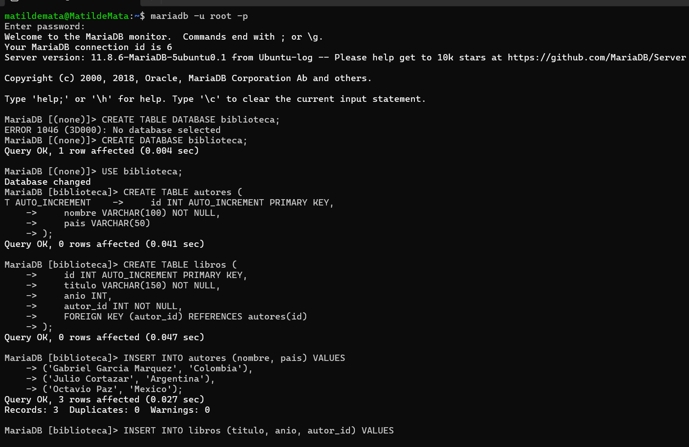
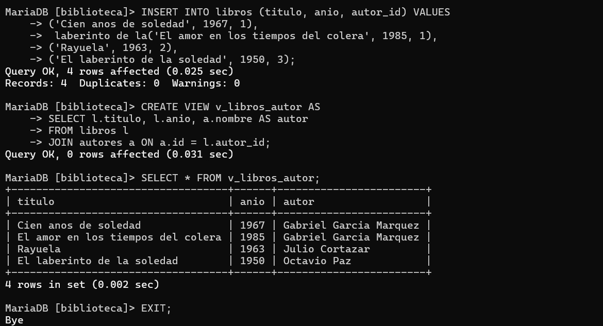
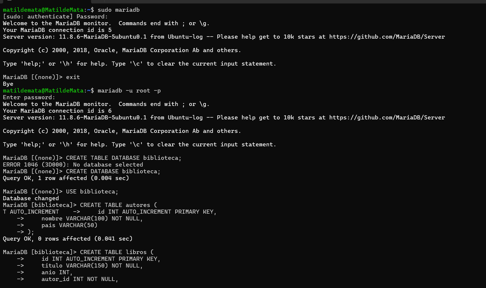
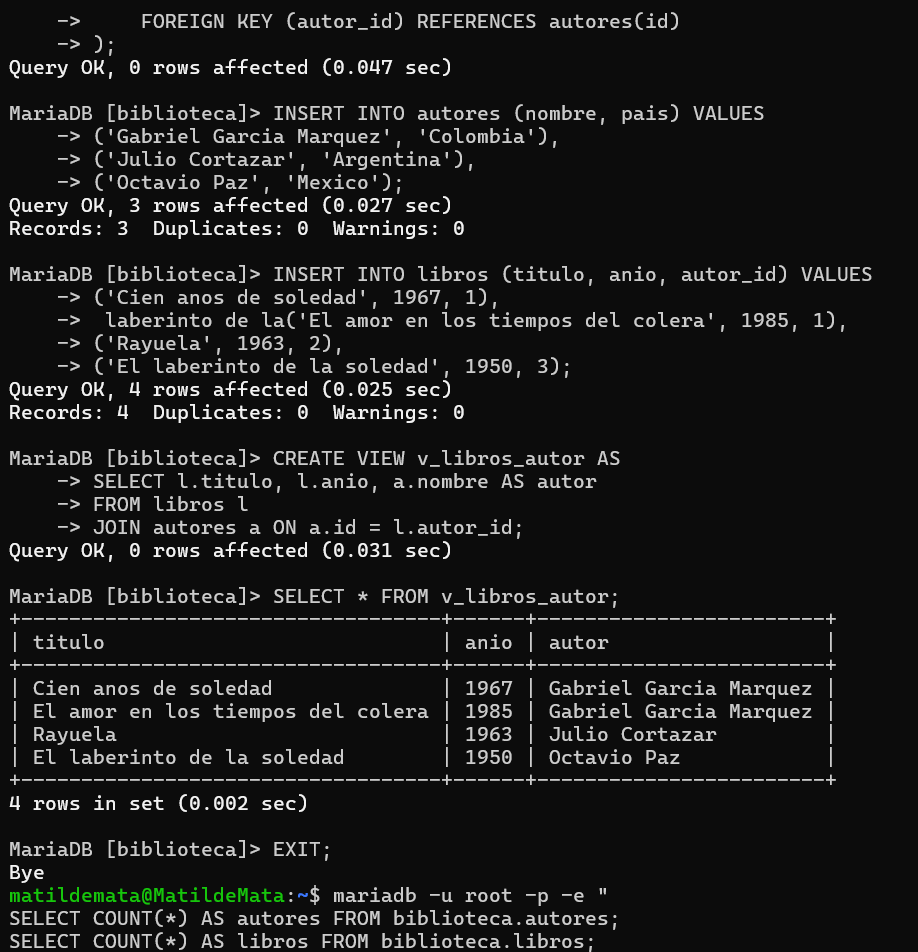
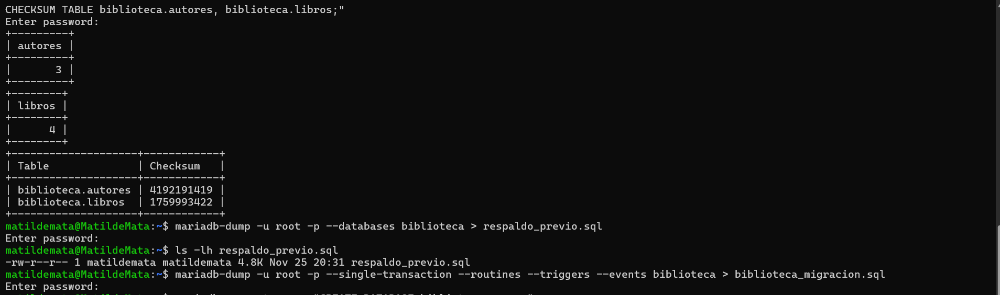
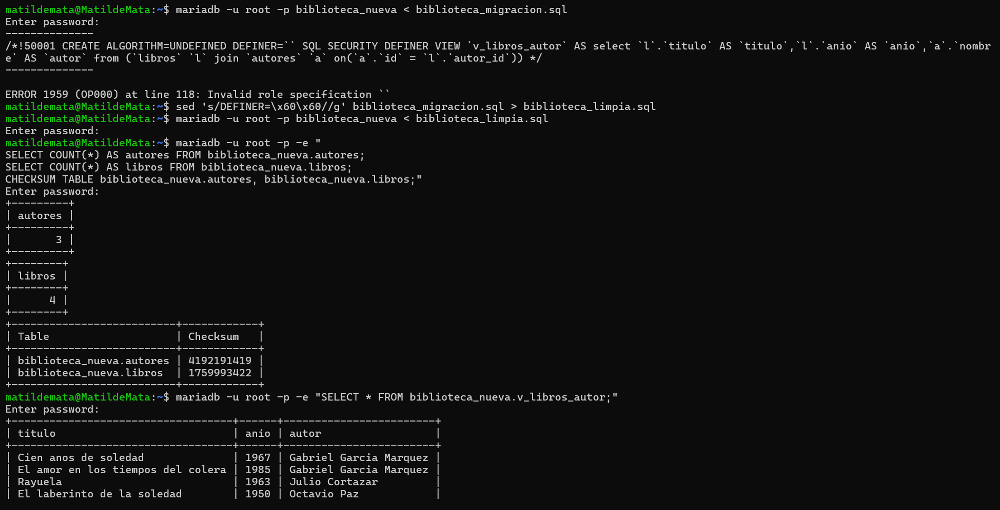
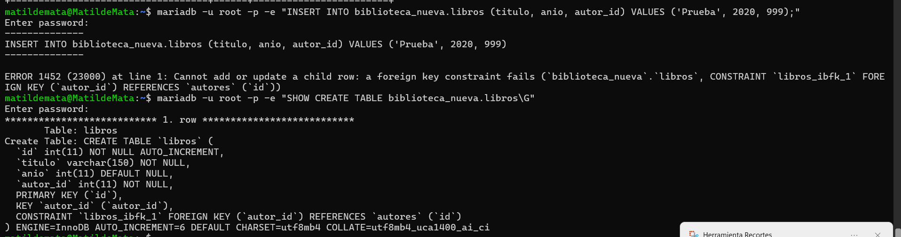

## Nombre de la institución: INSTITUTO TECNOLOGICO DE MILPA ALTA II

### Asignatura: Administración de Bases de Datos

### Práctica: Práctica 2 – Migración de una base de datos en MariaDB

### Nombre del alumno: Meza Galvan Xochitl Valeria

### Nombre del docente: Ing. Diego Alberto Bollas Paredes

### Grupo: SIS5

### Fecha de elaboración: 25-11-26

***Introducción***

En esta práctica trabajamos con MariaDB para crear una base de datos, organizar su información mediante tablas relacionadas y realizar una migración hacia una nueva base de datos. Durante el procedimiento aprendimos a utilizar diferentes comandos SQL y de Linux que nos permiten crear estructuras, insertar información, consultar registros, realizar respaldos y restaurar bases de datos.


## 1. Ingresar a MariaDB

Para ingresar al monitor de MariaDB utilizamos el siguiente comando:

```bash
mariadb -u root -p
```

- `mariadb`: abre el monitor de MariaDB.
- `-u`: indica el usuario con el que nos conectaremos.
- `root`: usuario administrador.
- `-p`: solicita la contraseña.

También podemos ingresar directamente como administrador del sistema:

```bash
sudo mariadb
```

Para salir del monitor utilizamos:

```sql
EXIT;
```



---

## 2. Crear la base de datos de origen

Primero creamos la base de datos donde almacenaremos la información de nuestra biblioteca.

```sql
CREATE DATABASE biblioteca;
USE biblioteca;
```

- `CREATE DATABASE`: crea una nueva base de datos.
- `USE`: selecciona la base de datos que vamos a utilizar.

---

## 3. Crear las tablas

### Tabla autores

Creamos la tabla `autores` para almacenar los nombres de los escritores y su país de origen.

```sql
CREATE TABLE autores (
    id INT AUTO_INCREMENT PRIMARY KEY,
    nombre VARCHAR(100) NOT NULL,
    pais VARCHAR(50)
);
```

- `INT`: almacena números enteros.
- `AUTO_INCREMENT`: genera automáticamente un número consecutivo.
- `PRIMARY KEY`: identifica de manera única cada registro.
- `VARCHAR`: almacena texto.
- `NOT NULL`: indica que el campo no puede quedar vacío.

### Tabla libros

Creamos la tabla `libros` para almacenar los títulos, año de publicación y el identificador del autor.

```sql
CREATE TABLE libros (
    id INT AUTO_INCREMENT PRIMARY KEY,
    titulo VARCHAR(150) NOT NULL,
    anio INT,
    autor_id INT NOT NULL,
    FOREIGN KEY (autor_id) REFERENCES autores(id)
);
```

- `FOREIGN KEY`: establece una llave foránea.
- `REFERENCES autores(id)`: relaciona los libros con el identificador de los autores.

Esto permite relacionar ambas tablas y evitar que un libro tenga un autor que no exista.

---

## 4. Insertar datos en las tablas

### Insertar autores

Utilizamos `INSERT INTO` para agregar registros a la tabla autores.

```sql
INSERT INTO autores (nombre, pais) VALUES
('Gabriel Garcia Marquez', 'Colombia'),
('Julio Cortazar', 'Argentina'),
('Octavio Paz', 'Mexico');
```

- `INSERT INTO`: inserta datos en una tabla.
- `VALUES`: indica los valores que se van a registrar.
- Los textos se escriben entre comillas simples.

### Insertar libros

Agregamos los libros indicando su título, año y el ID de su autor.

```sql
INSERT INTO libros (titulo, anio, autor_id) VALUES
('Cien anos de soledad', 1967, 1),
('El amor en los tiempos del colera', 1985, 1),
('Rayuela', 1963, 2),
('El laberinto de la soledad', 1950, 3);
```

En `autor_id` colocamos el identificador del autor al que pertenece cada libro.

---

## 5. Crear una vista de libros y autores

Creamos una vista para mostrar los libros junto con el nombre de sus autores.

```sql
CREATE VIEW v_libros_autor AS
SELECT l.titulo, l.anio, a.nombre AS autor
FROM libros l
JOIN autores a ON a.id = l.autor_id;
```

- `CREATE VIEW`: crea una vista.
- `SELECT`: selecciona las columnas que se mostrarán.
- `AS autor`: asigna el nombre autor a la columna.
- `JOIN`: une información de dos tablas.
- `ON`: establece la condición de unión.
- `l` y `a`: son alias que representan las tablas libros y autores.

La vista permite consultar los datos de ambas tablas sin tener que escribir nuevamente toda la consulta de unión.

### Consultar la vista

```sql
SELECT * FROM v_libros_autor;
```

- `SELECT *`: muestra todas las columnas.
- `FROM`: indica de dónde se obtienen los datos.

---

## 6. Ejecutar consultas desde la terminal

Podemos ejecutar consultas SQL directamente desde Linux sin entrar al monitor de MariaDB, utilizando el parámetro `-e`.

```bash
mariadb -u root -p -e "SELECT COUNT(*) AS autores FROM biblioteca.autores;"
```

- `-e`: ejecuta una instrucción SQL directamente desde la terminal.
- `COUNT(*)`: cuenta todos los registros.
- `AS autores`: asigna el nombre autores al resultado.

Para contar los libros utilizamos:

```bash
mariadb -u root -p -e "SELECT COUNT(*) AS libros FROM biblioteca.libros;"
```

---

## 7. Comprobar las tablas mediante CHECKSUM

Utilizamos `CHECKSUM TABLE` para obtener un valor de comprobación de las tablas.

```bash
mariadb -u root -p -e "CHECKSUM TABLE biblioteca.autores, biblioteca.libros;"
```

- `CHECKSUM TABLE`: calcula un valor de comprobación de las tablas.
- Permite comparar los datos de la base de origen con los de la base destino después de realizar una migración.

En nuestra práctica se obtuvieron los siguientes resultados:

- Autores: 3 registros.
- Libros: 4 registros.

---

## 8. Crear un respaldo de la base de datos

Para generar un respaldo de la base de datos utilizamos el comando `mariadb-dump`.

```bash
mariadb-dump -u root -p --databases biblioteca > respaldo_previo.sql
```

- `mariadb-dump`: genera un respaldo de la base de datos.
- `-u root`: indica el usuario.
- `-p`: solicita la contraseña.
- `--databases`: indica que se respaldará una base de datos.
- `biblioteca`: nombre de la base de datos.
- `>`: redirecciona la salida a un archivo.
- `respaldo_previo.sql`: archivo donde se guardará el respaldo.

### Verificar el archivo

```bash
ls -lh respaldo_previo.sql
```

- `ls`: muestra los archivos.
- `-l`: muestra información detallada.
- `-h`: muestra el tamaño de manera legible.

---

----

## 9. Crear un respaldo para migración

Para realizar una migración utilizamos un respaldo que incluya los elementos adicionales de la base de datos.

```bash
mariadb-dump -u root -p --single-transaction --routines --triggers --events biblioteca > biblioteca_migracion.sql
```

- `--single-transaction`: realiza el respaldo mediante una transacción, para mantener consistencia en tablas compatibles.
- `--routines`: incluye funciones y procedimientos almacenados.
- `--triggers`: incluye los triggers.
- `--events`: incluye eventos programados.
- `biblioteca_migracion.sql`: archivo que contiene el respaldo para la migración.

---

## 10. Crear la base de datos destino

Creamos una nueva base de datos donde restauraremos la información de la base original.

```sql
CREATE DATABASE biblioteca_nueva;
```

La base `biblioteca_nueva` será nuestro destino y recibirá los datos de la base de origen `biblioteca`.

---


---

---

----
## 11. Importar el respaldo

Utilizamos el operador `<` para importar el contenido del archivo SQL a la base de datos destino.

```bash
mariadb -u root -p biblioteca_nueva < biblioteca_migracion.sql
```

- `biblioteca_nueva`: base de datos destino.
- `<`: redirecciona el contenido del archivo hacia MariaDB.
- `biblioteca_migracion.sql`: archivo que contiene las instrucciones de restauración.

### Diferencia entre los operadores

- `>`: guarda la salida de un comando en un archivo.
- `<`: utiliza un archivo como entrada de un comando.

---

## 12. Corregir el error DEFINER con SED

Durante la importación se presentó un error relacionado con `DEFINER` en la definición de la vista.

`DEFINER` indica el usuario que está asociado a la creación de un objeto, como una vista o procedimiento. Al migrar, ese usuario puede no existir o no ser válido en el nuevo servidor.

Para limpiar el archivo SQL utilizamos `sed`.

```bash
sed 's/DEFINER=\\x60.*\\x60@\\x60%\\x60//g' biblioteca_migracion.sql > biblioteca_limpia.sql
```

- `sed`: permite buscar y reemplazar texto en archivos.
- `s`: indica una sustitución.
- `DEFINER`: texto que se busca para eliminar.
- `g`: aplica la sustitución global.
- `>`: guarda el resultado en otro archivo.
- `biblioteca_limpia.sql`: archivo corregido.

De esta manera generamos un nuevo archivo sin la especificación `DEFINER` que provocaba problemas durante la importación.

---

---

## 13. Importar el archivo limpio

Después de corregir el archivo realizamos nuevamente la importación.

```bash
mariadb -u root -p biblioteca_nueva < biblioteca_limpia.sql
```

Este comando lee el archivo `biblioteca_limpia.sql` y ejecuta las instrucciones SQL en la base de datos `biblioteca_nueva`.

---

## 14. Verificar que la migración se realizó correctamente

Para comprobar que la información se transfirió correctamente ejecutamos consultas de conteo y checksum.

```bash
mariadb -u root -p -e "
SELECT COUNT(*) AS autores FROM biblioteca_nueva.autores;
SELECT COUNT(*) AS libros FROM biblioteca_nueva.libros;
CHECKSUM TABLE biblioteca_nueva.autores, biblioteca_nueva.libros;"
```



## TABLA

| Comprobación | Biblioteca original | Biblioteca nueva |
|---|---:|---:|
| Autores | 3 | 3 |
| Libros | 4 | 4 |
| Checksum autores | 4192191419 | 4192191419 |
| Checksum libros | 1759993422 | 1759993422 |

### ***Conclusión***

En esta práctica aprendimos a realizar el proceso de migración de una base de datos utilizando MariaDB y la terminal de Linux. Comenzamos creando una base de datos llamada biblioteca, donde generamos las tablas autores y libros, estableciendo relaciones mediante llaves primarias y foráneas. Después insertamos registros y creamos una vista para consultar los libros junto con sus autores.

Posteriormente realizamos respaldos de la base de datos utilizando mariadb-dump, aprendimos a utilizar los operadores de redirección > y < para guardar e importar archivos SQL, y creamos una nueva base de datos llamada biblioteca_nueva para recibir la información migrada.

