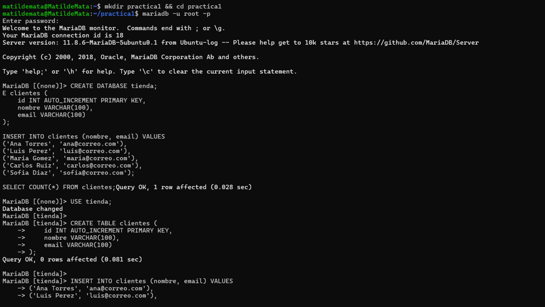
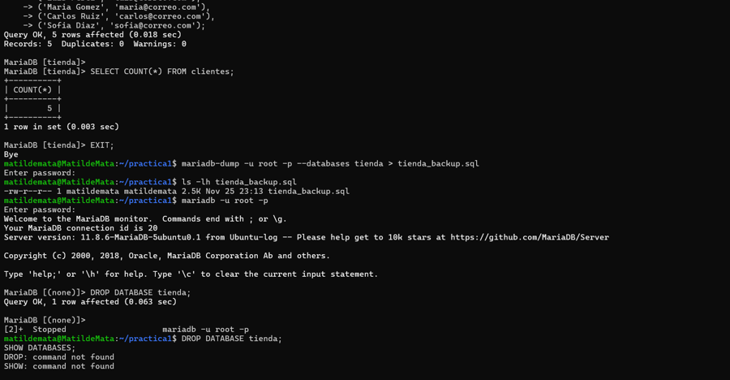
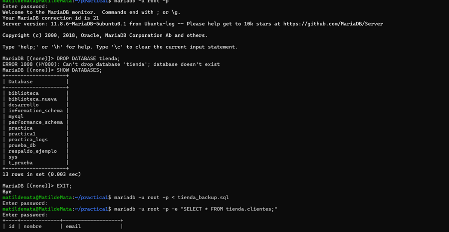
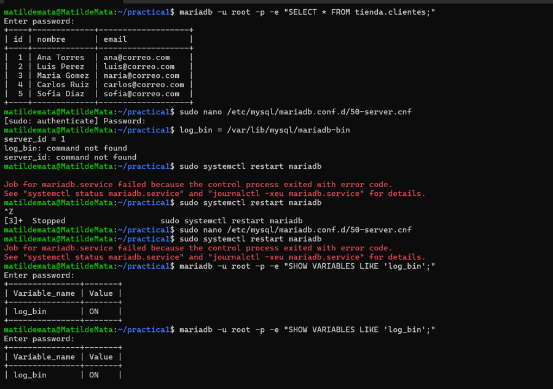
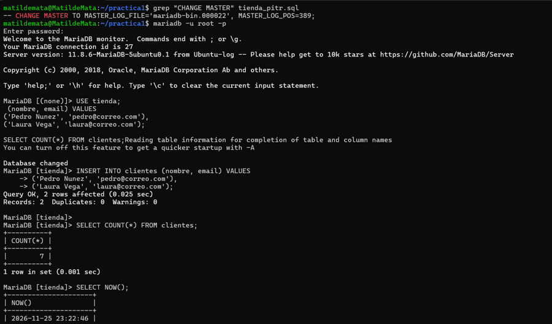
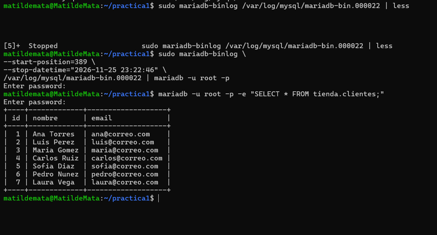

## Nombre de la institución: INSTITUTO TECNOLOGICO DE MILPA ALTA II

### Asignatura: Administración de Bases de Datos

### Práctica: Respaldo, restauración y recuperación de datos mediante registros binarios en MariaDB


### Nombre del alumno: Meza Galvan Xochitl Valeria

### Nombre del docente: Ing. Diego Alberto Bollas Paredes

### Grupo: SIS5

### Fecha de elaboración: 25-11-26


---

# Introducción

En esta práctica se trabajó con MariaDB para conocer el procedimiento de respaldo y recuperación de una base de datos. Se creó una base de datos llamada `tienda`, en la cual se almacenaron registros de clientes para posteriormente realizar una copia de seguridad.

Después se realizó un respaldo mediante el comando `mariadb-dump`, se eliminó la base de datos y se llevaron a cabo pruebas de restauración. También se revisó la configuración de los registros binarios (*Binary Logs*), los cuales permiten registrar cambios realizados en la base de datos y recuperar información después de determinadas operaciones.

Esta práctica permite comprender la importancia de realizar respaldos y conocer cómo recuperar información cuando los datos han sido eliminados accidentalmente.

---

# Objetivo

Aprender a realizar respaldos de una base de datos MariaDB, restaurar la información mediante un archivo `.sql` y utilizar los registros binarios para recuperar cambios realizados en la base de datos.

---

# Desarrollo de la práctica

## Paso 1. Crear el directorio de trabajo

Se creó un directorio llamado `practical1`, donde se guardarían los archivos relacionados con la práctica.

```bash
mkdir practical1 && cd practical1
```

**¿Qué hace este comando?**

- `mkdir`: crea un nuevo directorio.
- `practical1`: es el nombre del directorio.
- `&&`: permite ejecutar el siguiente comando solamente si el anterior se ejecutó correctamente.
- `cd`: entra al directorio creado.

---


## Paso 2. Ingresar a MariaDB

Se ingresó al administrador de bases de datos utilizando el usuario root.

```bash
mariadb -u root -p
```

- `mariadb`: inicia el cliente de MariaDB.
- `-u root`: indica que se utilizará el usuario root.
- `-p`: solicita la contraseña del usuario.

Al ingresar correctamente, se muestra el monitor de MariaDB, desde donde se pueden ejecutar instrucciones SQL.

---

## Paso 3. Crear la base de datos

Se creó una base de datos llamada `tienda`.

```sql
CREATE DATABASE tienda;
```

El comando `CREATE DATABASE` sirve para crear una nueva base de datos donde se almacenarán tablas y registros.

---

## Paso 4. Crear la tabla de clientes

Se creó una tabla llamada `clientes`, que almacena el identificador, nombre y correo electrónico de cada cliente.

```sql
USE tienda;

CREATE TABLE clientes (
    id INT AUTO_INCREMENT PRIMARY KEY,
    nombre VARCHAR(100),
    email VARCHAR(100)
);
```

### Explicación de los elementos utilizados

- `USE tienda`: selecciona la base de datos que se va a utilizar.
- `CREATE TABLE`: crea una nueva tabla.
- `id`: identifica a cada cliente.
- `INT`: almacena números enteros.
- `AUTO_INCREMENT`: aumenta automáticamente el identificador.
- `PRIMARY KEY`: identifica de manera única cada registro.
- `VARCHAR(100)`: almacena texto de hasta 100 caracteres.

---

## Paso 5. Insertar registros

Se agregaron cinco clientes a la tabla.

```sql
INSERT INTO clientes (nombre, email) VALUES
('Ana Torres', 'ana@correo.com'),
('Luis Perez', 'luis@correo.com'),
('Maria Gomez', 'maria@correo.com'),
('Carlos Ruiz', 'carlos@correo.com'),
('Sofia Diaz', 'sofia@correo.com');
```

El comando `INSERT INTO` permite agregar información a una tabla.

En este caso se insertaron cinco registros con sus respectivos nombres y correos electrónicos.

---

---

---

## Paso 7. Crear el respaldo de la base de datos

Se salió de MariaDB y se realizó un respaldo de la base de datos `tienda`.

```bash
mariadb-dump -u root -p --databases tienda > tienda_backup.sql
```

- `mariadb-dump`: herramienta para generar respaldos.
- `-u root`: utiliza el usuario root.
- `-p`: solicita la contraseña.
- `--databases tienda`: indica que se exportará la base de datos tienda incluyendo su creación.
- `>`: redirige el resultado hacia un archivo.
- `tienda_backup.sql`: nombre del archivo de respaldo.

El respaldo se guarda en un archivo SQL que contiene las instrucciones necesarias para reconstruir la base de datos y sus datos.

---

## Paso 8. Comprobar el archivo de respaldo

Se verificó que el archivo se hubiera creado correctamente.

```bash
ls -lh tienda_backup.sql
```

El comando `ls` muestra los archivos del directorio.

La opción `-l` muestra información detallada, mientras que `-h` presenta los tamaños de los archivos de manera más fácil de leer.


---

---

## Paso 9. Eliminar la base de datos original

Se ingresó nuevamente a MariaDB y se eliminó la base de datos `tienda`.

```sql
DROP DATABASE tienda;
```

El comando `DROP DATABASE` elimina una base de datos completa, incluyendo sus tablas y registros.

Este paso se realizó para simular una pérdida de información y comprobar el proceso de recuperación utilizando el respaldo.


---

---

## Paso 10. Comprobar si la base de datos existe

Se utilizó el siguiente comando:

```sql
SHOW DATABASES;
```

Este comando muestra todas las bases de datos disponibles en el servidor MariaDB.

Al revisar los resultados, se comprobó que `tienda` ya no aparecía en la lista.

### Error presentado

En una ocasión se intentó ejecutar:

```bash
DROP DATABASE tienda;
SHOW DATABASES;
```

desde la terminal de Linux.

Esto generó errores como:

```text
DROP: command not found
SHOW: command not found
```

---

## Paso 11. Restaurar el respaldo

Se intentó importar el respaldo utilizando el archivo SQL.

```bash
mariadb -u root -p < tienda_backup.sql
```

El símbolo `<` permite enviar el contenido del archivo como entrada al programa MariaDB.

De esta forma, se ejecutan las instrucciones SQL almacenadas dentro del archivo de respaldo.

Como el respaldo fue realizado utilizando `--databases`, el archivo contiene instrucciones para crear nuevamente la base de datos y cargar su estructura y registros.

---


---
## Paso 12. Verificar la restauración

Se realizó una consulta para visualizar los clientes recuperados.

```bash
mariadb -u root -p -e "SELECT * FROM tienda.clientes;"
```

### Explicación

- `-e`: permite ejecutar una consulta directamente desde la terminal.
- `SELECT *`: muestra todas las columnas.
- `FROM tienda.clientes`: indica que se consultarán los datos de la tabla clientes dentro de la base tienda.

Se observaron nuevamente los cinco clientes originales, lo que permitió comprobar que los datos del respaldo podían recuperarse.


---

# Paso 13. Revisar la configuración de los registros binarios

Se abrió el archivo de configuración de MariaDB para revisar sus parámetros.

```bash
sudo nano /etc/mysql/mariadb.conf.d/50-server.cnf
```

- `sudo`: ejecuta el comando con permisos de administrador.
- `nano`: abre un editor de texto en la terminal.
- La ruta indica el archivo de configuración del servidor MariaDB.

Se revisaron los parámetros relacionados con los registros binarios, entre ellos `log_bin` y `server_id`.

### ¿Qué son los Binary Logs?

Los registros binarios o *Binary Logs* almacenan eventos y cambios que se realizan en una base de datos, como inserciones, modificaciones y eliminaciones.

Estos registros son útiles para recuperar información y reconstruir operaciones realizadas después de un respaldo.

---

---

# Paso 14. Reiniciar el servicio MariaDB

Se intentó reiniciar el servicio para aplicar los cambios de configuración.

```bash
sudo systemctl restart mariadb
```

El comando `systemctl restart` detiene y vuelve a iniciar un servicio.

### Error presentado

En la práctica apareció el mensaje:

```text
Job for mariadb.service failed because the control process exited with error code.
```

Esto significa que MariaDB no pudo reiniciarse correctamente.

El problema se presentó después de intentar modificar la configuración, por lo que fue necesario revisar los parámetros y el estado del servicio.

También se ejecutaron algunos comandos en la terminal que no correspondían al lugar donde debían escribirse.

Por ejemplo:

```bash
log_bin = /var/lib/mysql/mariadb-bin
server_id = 1
```


Estas líneas son parámetros de configuración y deben colocarse dentro del archivo de configuración de MariaDB, no ejecutarse como comandos en Linux.

---

# Paso 15. Comprobar si los registros binarios están activos

Se utilizó la siguiente consulta:

```bash
mariadb -u root -p -e "SHOW VARIABLES LIKE 'log_bin';"
```

Esta instrucción permite consultar la variable `log_bin`.

El resultado fue:

| Variable | Valor |
|---|---|
| log_bin | ON |

Esto significa que los registros binarios se encontraban habilitados en el servidor.

---

# Paso 16. Insertar nuevos registros

Se agregaron dos clientes nuevos a la tabla `clientes`.

```sql
USE tienda;

INSERT INTO clientes (nombre, email) VALUES
('Pedro Nunez', 'pedro@correo.com'),
('Laura Vega', 'laura@correo.com');
```

Con estos registros, la tabla pasó de tener cinco a siete clientes.

---

# Paso 17. Comprobar el número de registros

Se volvió a utilizar la consulta:

```sql
SELECT COUNT(*) FROM clientes;
```

El resultado fue de **7 registros**.

Esto permitió verificar que los dos clientes nuevos se habían agregado correctamente.

---

# Paso 18. Consultar la fecha y hora

Se ejecutó el siguiente comando:

```sql
SELECT NOW();
```

Esta función devuelve la fecha y hora actuales del servidor de MariaDB.

En la práctica se obtuvo la fecha y hora:

`2026-11-25 23:22:46`

Este dato es importante porque puede utilizarse como referencia para recuperar los cambios realizados hasta un momento determinado.

---

# Paso 19. Eliminar todos los registros

Se ejecutó el comando:

```sql
DELETE FROM clientes;
```

Este comando elimina todos los registros de la tabla, pero conserva la estructura de la tabla.

Posteriormente se verificó la cantidad de registros:

```sql
SELECT COUNT(*) FROM clientes;
```

El resultado fue **0**, lo que confirmó que los siete clientes habían sido eliminados.

### Diferencia entre DROP y DELETE

- `DROP DATABASE`: elimina una base de datos completa.
- `DELETE FROM clientes`: elimina los registros de una tabla, pero la tabla continúa existiendo.

---

# Paso 20. Revisar el registro binario

Se utilizó el comando `mariadb-binlog` para revisar y procesar los eventos almacenados en los registros binarios.

```bash
sudo mariadb-binlog /var/log/mysql/mariadb-bin.000022 | less
```

- `mariadb-binlog`: herramienta que permite leer registros binarios.
- La ruta indica el archivo de registro que se desea revisar.
- `|`: envía la salida de un comando hacia otro.
- `less`: permite visualizar el contenido por páginas.

También se revisó la posición de los eventos con el siguiente comando:

```bash
grep "CHANGE MASTER" tienda_pitr.sql
```

La instrucción `grep` busca una palabra o texto dentro de un archivo.

En este caso se buscó `CHANGE MASTER` para localizar información relacionada con las posiciones del registro binario.

---

---
# Paso 21. Recuperación de los datos mediante Binary Logs

Se utilizó una instrucción para procesar los eventos del registro binario desde una posición específica y hasta una fecha y hora determinada.

```bash
sudo mariadb-binlog \
--start-position=389 \
--stop-datetime="2026-11-25 23:22:46" \
/var/log/mysql/mariadb-bin.000022 | mariadb -u root -p
```


### Explicación de las opciones

- `sudo`: ejecuta el comando con permisos de administrador.
- `mariadb-binlog`: procesa los eventos almacenados.
- `--start-position=389`: indica la posición inicial desde donde se procesarán los eventos.
- `--stop-datetime`: establece la fecha y hora límite de recuperación.
- `/var/log/mysql/mariadb-bin.000022`: indica el archivo de registro binario.
- `|`: envía los eventos procesados hacia MariaDB.
- `mariadb -u root -p`: recibe y ejecuta las instrucciones de recuperación en la base de datos.

Este procedimiento permite recuperar las operaciones almacenadas en el registro binario hasta un momento determinado.

---

# Paso 22. Comprobar los datos recuperados

Finalmente, se consultó nuevamente la tabla de clientes.

```bash
mariadb -u root -p -e "SELECT * FROM tienda.clientes;"
```

En el resultado se visualizaron los siete clientes:

| ID | Nombre | Correo |
|---:|---|---|
| 1 | Ana Torres | ana@correo.com |
| 2 | Luis Perez | luis@correo.com |
| 3 | Maria Gomez | maria@correo.com |
| 4 | Carlos Ruiz | carlos@correo.com |
| 5 | Sofia Diaz | sofia@correo.com |
| 6 | Pedro Nunez | pedro@correo.com |
| 7 | Laura Vega | laura@correo.com |

Esto permitió comprobar que los datos de la tabla estaban nuevamente disponibles después de la eliminación.


---

# Conceptos importantes de la práctica

| Concepto | Explicación |
|---|---|
| Respaldo | Copia de seguridad de una base de datos para proteger la información. |
| Restauración | Recuperar una base de datos utilizando un respaldo. |
| Binary Logs | Registros que almacenan eventos y cambios realizados en MariaDB. |
| Recuperación puntual | Recuperar los cambios hasta una fecha, hora o posición determinada. |
| `mariadb-dump` | Herramienta utilizada para exportar bases de datos. |
| `mariadb-binlog` | Herramienta que permite leer y procesar registros binarios. |
| `COUNT(*)` | Cuenta los registros existentes en una tabla. |
| `NOW()` | Devuelve la fecha y hora actuales del servidor. |
| `DELETE` | Elimina registros de una tabla. |
| `DROP DATABASE` | Elimina una base de datos completa. |

---

# Conclusión

En esta práctica se aprendió a crear una base de datos en MariaDB, insertar información, verificar registros y realizar un respaldo mediante `mariadb-dump`.

También se comprobó la importancia de guardar copias de seguridad antes de realizar cambios que puedan afectar los datos. Se eliminó información de la base de datos y se trabajó con el proceso de restauración, además de revisar los registros binarios para comprender cómo permiten recuperar operaciones realizadas en el servidor.

Durante el desarrollo aparecieron errores al ejecutar comandos SQL directamente en la terminal de Linux y al intentar reiniciar el servicio MariaDB después de modificar su configuración. Esto permitió identificar que los comandos SQL deben ejecutarse dentro del monitor de MariaDB y que los parámetros de configuración deben escribirse correctamente en sus archivos correspondientes.

Finalmente, la práctica permitió comprender que los respaldos y los registros binarios son herramientas fundamentales para la seguridad, protección y recuperación de la información de una base de datos.